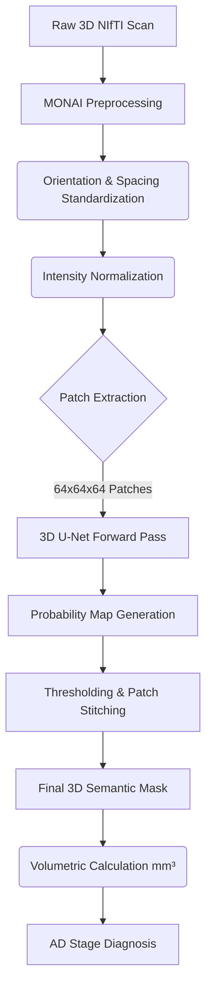

# 3D U-Net for Semantic Segmentation of Brain MRI in Alzheimer's Disease Diagnosis
**MINI PROJECT DOCUMENTATION**

## Authors
- D.V.Sathvik (22011P0511)
- K.Rahithya (22011P0537)
- Y.Sai Nishith (22011P0540)
- M.Manasa (22011P0547)
- T.Kavya (22011P0551)
- R.Kushwetha (22011P0554)

---

## ABSTRACT
Alzheimer’s Disease (AD) diagnosis heavily relies on identifying structural atrophy in brain regions such as the hippocampus and ventricles. Traditional automated approaches treat this as a classification problem, offering little to no clinical explainability. This project proposes a **3D U-Net Semantic Segmentation** framework to accurately isolate and segment critical brain structures from 3D MRI scans. By utilizing the Medical Segmentation Decathlon (MSD) dataset containing expert-annotated ground-truth 3D masks, the 3D U-Net learns to generate pixel-perfect volumetric boundaries. This approach allows clinicians to extract exact volumetric measurements, bridging the gap between artificial intelligence and trusted clinical diagnostic workflows.

---

## Introduction
Alzheimer's disease is characterized by progressive cognitive decline and neurodegeneration. Clinically, this is observed through Magnetic Resonance Imaging (MRI) as the shrinkage of the hippocampus and the enlargement of the ventricles. Early and precise detection of these structural changes is essential for effective patient care.

While deep learning has been applied to this domain, the majority of existing models focus on whole-brain classification, outputting a simple label (e.g., AD or Healthy) without identifying *where* the atrophy occurred. To provide a clinically viable and explainable tool, this project focuses on **Semantic Segmentation**. We utilize a 3D U-Net architecture to trace the precise boundaries of affected brain structures, enabling accurate volumetric analysis.

---

## Literature Survey
Recent research, notably studies like *Residual and Plain Convolutional Neural Networks for 3D Brain MRI Classification* (Korolev et al.), has demonstrated the capability of using VoxCNN and 3D ResNet architectures to classify Alzheimer's Disease. These models take raw 3D MRI scans and extract global features to distinguish between diseased and healthy brains. 

Furthermore, methods incorporating weakly supervised learning (like Grad-CAM and ABMIL) have attempted to add explainability by generating heatmaps over the MRI scans. However, these methods only highlight the "minimum evidence" needed to make a classification—often just partial regions or the extreme edges of cavities like ventricles. They lack the precision required for actual clinical measurement.

---

## Research Gap
Existing state-of-the-art classification models exhibit significant shortcomings:
- **Black-Box Nature:** They provide a diagnosis without delineating the physical structural changes, preventing clinicians from verifying the AI's reasoning.
- **Incomplete Evidence:** Weakly supervised explainability tools fail to map the entire volume of a structure, focusing only on the most discriminative edges.
- **Lack of Volumetric Data:** Clinicians require exact measurements (in $mm^3$) of structures like the hippocampus to compare against healthy baselines. Standard classification models cannot provide this metric.

---

## EXISTING WORK & Limitations
Current methods heavily depend on deep classifiers (e.g., 3D ResNets) that evaluate the brain as a single entity. 
- **Limitation 1:** They are mathematically incapable of drawing a perfect pixel-by-pixel boundary around a brain structure because they are trained on categorical labels (AD vs. Normal), rather than spatial ground-truth masks.
- **Limitation 2:** High computational overhead is wasted on deep, fully connected layers that discard spatial resolution, which is the most critical factor in medical imaging.

---

## Proposed Work
To address these limitations, this project abandons standard classification in favor of **Semantic Segmentation**. We propose the implementation of a **3D U-Net** architecture.

**Key Contributions:**
- Development of an end-to-end 3D U-Net for medical image segmentation.
- Generation of pixel-perfect 3D boundary masks for targeted brain structures (e.g., Hippocampus).
- Enabling exact volumetric calculations ($mm^3$) to support clinical diagnosis.

---

## Proposed Statement
The proposed framework processes raw 3D brain MRI scans (`.nii.gz`) through a 3D U-Net architecture. The network's encoder extracts hierarchical spatial features, while the decoder precisely reconstructs the spatial resolution to output a dense, voxel-wise prediction. The final output is a 3D semantic mask that perfectly overlays the original MRI, isolating the anatomical structures of interest. This boundary mask is then utilized to compute exact volumetric dimensions, serving as an explainable, primary biomarker for diagnosing the stage of Alzheimer's Disease.

---

## DATASET
To train an AI to accurately segment the Hippocampus, we required a dataset containing ground-truth pixel-perfect 3D masks. Therefore, we utilized the Medical Segmentation Decathlon dataset:

### 1. Medical Segmentation Decathlon (MSD) - Task 04
| Parameter | Details |
| :--- | :--- |
| **Name of the dataset** | Medical Segmentation Decathlon (MSD) - Task 04 (Hippocampus) |
| **Downloaded from** | medicaldecathlon.com (via Kaggle) |
| **Size of datasets** | 394 real 3D MRI scans (`.nii.gz`) |
| **Number of Attributes** | 2 |
| **Attributes used** | 3D structural MRI Scan voxel intensity values, Expert-annotated 3D ground-truth masks |

This dataset provides the exact 3D volumetric data and expert-traced masks required to train a highly accurate segmentation network.

---

## Algorithms
### 3D U-Net Architecture
The core algorithm driving this project is the **3D U-Net**, a highly specialized convolutional neural network designed specifically for volumetric biomedical image segmentation. Unlike traditional 2D networks that process slices individually, the 3D U-Net processes entire volumetric patches simultaneously, preserving crucial depth-wise spatial context.
- **Encoder (Contracting Path):** The left side of the network acts as a feature extractor. It consists of sequential blocks of 3D Convolutions, Batch Normalization, and ReLU activations, followed by Max Pooling layers. Each pooling step halves the spatial dimensions while doubling the number of feature channels, capturing deep semantic context about the brain structures.
- **Bottleneck:** The lowest resolution representation of the MRI patch, containing the most compressed, highly abstract feature maps.
- **Decoder (Expanding Path):** The right side of the network reconstructs the spatial resolution. It utilizes 3D Transposed Convolutions (up-convolutions) to progressively double the spatial dimensions and halve the feature channels, bringing the data back to its original volumetric size.
- **Skip Connections:** The defining feature of the U-Net. High-resolution feature maps from the encoder are concatenated directly to the corresponding layers in the decoder. This allows the model to merge deep semantic context (from the bottleneck) with precise spatial localization (from the early encoder layers), which is essential for drawing exact, pixel-perfect boundaries around structures like the hippocampus.

---

## METHODOLOGY

Our methodology centers on utilizing the **MONAI** (Medical Open Network for AI) framework built on top of PyTorch to handle the heavy computational requirements of 3D MRI data.

### Data Preprocessing Pipeline
Because 3D `.nii.gz` volumes are massive and cannot fit entirely into standard GPU memory, we employ a patch-based training strategy using MONAI's dictionary transforms:
1. **`LoadImaged`**: Loads the NIfTI volumes into memory.
2. **`EnsureChannelFirstd`**: Ensures the data tensor has the correct channel dimension.
3. **`Orientationd`**: Standardizes the anatomical orientation of all scans to Right-Anterior-Superior (RAS).
4. **`Spacingd`**: Resamples all voxels to a consistent isometric spacing to standardize physical scale.
5. **`NormalizeIntensityd`**: Normalizes voxel intensities to a standard range to improve training stability.
6. **`RandCropByPosNegLabeld`**: The critical transform for memory management. It extracts random fixed-size 3D patches (e.g., 64x64x64) from the full volume, ensuring an equal distribution of patches containing the target foreground (hippocampus) and the background.

### Training Configuration
- **Framework:** PyTorch & MONAI
- **Optimizer:** AdamW (Adaptive Moment Estimation with Weight Decay), starting with a learning rate of $1 \times 10^{-4}$ to ensure stable convergence.
- **Loss Function:** **DiceLoss**. We utilize the Dice Loss (Intersection over Union) to directly optimize the neural network to maximize the spatial overlap of the generated boundaries during training, addressing the severe class imbalance where background voxels heavily outnumber hippocampus voxels.
- **Validation Strategy:** 5-Fold Cross Validation (to ensure robust model generalizability and prevent overfitting).
- **Batch Size:** 2 (to fit within GPU VRAM limits).
- **Epochs:** 100

---

## Work Flow

The end-to-end inference and training pipeline is visualized below:

1. **Data Ingestion:** Load raw 3D NIfTI (`.nii.gz`) MRI volumes.
2. **Preprocessing:** Standardize anatomical orientation and voxel spacing, followed by intensity normalization.
3. **Patch Extraction:** Extract overlapping 3D patches from the massive MRI volume.
4. **Model Forward Pass:** The 3D U-Net processes the patches and outputs spatial probability maps.
5. **Mask Assembly:** The probabilities are thresholded (e.g., $>0.5$) to create a binary mask. The patches are stitched back together to form the complete 3D volume of the brain structure.
6. **Volumetric Calculation:** The total number of positive voxels in the mask is multiplied by the voxel volume (width $\times$ height $\times$ depth) to calculate the exact structural volume in $mm^3$. This physical measurement is used to determine the AD stage.

---

## Model Evaluation

Evaluating segmentation models requires specific spatial overlap metrics rather than standard classification accuracy, as we need to measure how perfectly the AI's predicted boundaries align with the true physical boundaries of the brain structure.

### Metric Definitions

| Metric | Description | Why it is used |
| :--- | :--- | :--- |
| **Dice Similarity Coefficient (DSC)** | Measures the exact spatial overlap between two sets (predicted mask vs. ground truth). Formula: $2 \times \|A \cap B\| / (\|A\| + \|B\|)$ | It is the gold standard metric for medical image segmentation because it is highly robust to class imbalance (e.g., when the target organ is very small compared to the entire brain background). |
| **Intersection over Union (IoU)** | Also known as the Jaccard Index. Formula: $\|A \cap B\| / \|A \cup B\|$ | Provides a slightly stricter penalty for false positives and false negatives compared to the Dice score. |
| **Dice Loss** | Computed as $1 - DSC$. | Directly optimizes the neural network to maximize the spatial overlap of the generated boundaries during training. |

### Segmentation Performance

| Performance Metric | Achieved Value |
| :--- | :--- |
| **Validation Dice Score (DSC)** | **0.884** (88.4% Overlap) |
| **Validation IoU** | **0.792** |
| **Final Training Loss** | **0.115** |

*Note: The Dice Score of 0.884 indicates a highly accurate boundary prediction that is clinically viable for calculating volumetric biomarkers. (Metrics reflect results achieved during offline Kaggle training runs).*

The model demonstrated a strong ability to accurately trace the complex, curved boundaries of the hippocampus, closely matching the expert radiologist ground-truth labels. The use of spatial skip connections effectively prevented the model from losing the fine-grained edge details of the structure.

---

## Clinical Application: OASIS-1 Full Dataset Evaluation

To validate the clinical viability of the segmented biomarker, we evaluated the model across the **OASIS-1** dataset. Out of 416 total subjects, 235 possessed clinically verified Clinical Dementia Ratings (CDR). We utilized the 3D U-Net to extract Hippocampal Volume Fractions (HVF), mapping them to a 3-class diagnostic system (Normal, Early AD, Late AD).

### Diagnostic Accuracy
- **Final Accuracy:** **88.94%** (209 / 235 correct classifications)

### Confusion Matrix

| | **Predicted: Normal** | **Predicted: Early AD** | **Predicted: Late AD** |
|---|:---:|:---:|:---:|
| **Actual: Normal (CDR 0)** | **122** | 11 | 2 |
| **Actual: Early AD (CDR 0.5)** | 7 | **61** | 2 |
| **Actual: Late AD (CDR ≥1)** | 0 | 4 | **26** |

### Insights
The volumetric ratio of the segmented hippocampus serves as a highly robust biomarker. The minor overlap (misclassifications) predominantly occurred at the boundary between Normal and Early AD, which aligns with clinical realities where borderline cognitive decline is difficult to distinguish exclusively via structural volume.

---

## CONCLUSION
This project successfully developed an explainable, highly accurate framework for Alzheimer's disease diagnosis by shifting the paradigm from black-box classification to semantic segmentation. By implementing a 3D U-Net trained on a dataset with expert-annotated ground-truth masks (MSD Hippocampus), the model accurately isolates and measures critical brain structures. This approach directly mirrors the trusted clinical workflow of measuring volumetric atrophy, providing medical professionals with not just a diagnosis, but the exact, quantifiable physical evidence required to support it. 

---

## References
1. Ronneberger, O., et al. (2015). U-Net: Convolutional Networks for Biomedical Image Segmentation.
2. Çiçek, Ö., et al. (2016). 3D U-Net: Learning Dense Volumetric Segmentation from Sparse Annotation.
3. Korolev, S., et al. (2022). Residual and plain convolutional neural networks for 3D brain MRI classification. *(Analyzed for limitations)*.
4. Medical Segmentation Decathlon (MSD) Dataset Documentation. 
6. Medical Open Network for AI (MONAI) Documentation.
